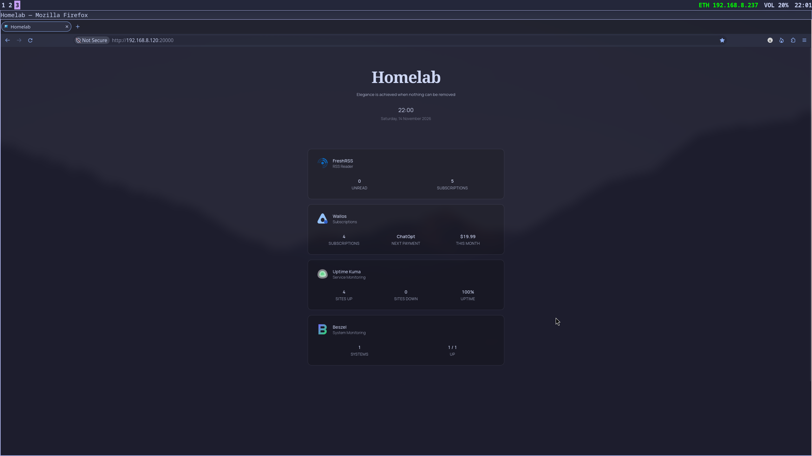
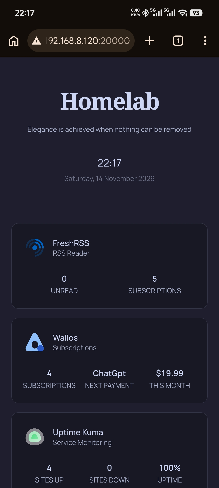

# Homelab

A minimal, self-hosted dashboard built with [Homepage](https://gethomepage.dev/) and styled with [Catppuccin Mocha](https://github.com/catppuccin/catppuccin).

> Elegance is achieved when nothing can be removed.

## Preview

### Desktop



### Mobile



## Features

- Minimal, blog-inspired interface
- Catppuccin Mocha dark color palette
- Responsive layout for desktop and mobile
- Live service statistics
- Custom typography and clock
- Clean, distraction-free design

## Services

| Category | Service | Purpose |
|---|---|---|
| Workspace | [FreshRSS](https://freshrss.org/) | RSS feed reader |
| Workspace | [Wallos](https://github.com/ellite/Wallos) | Subscription management |
| Infrastructure | [Uptime Kuma](https://github.com/louislam/uptime-kuma) | Uptime monitoring |
| Infrastructure | [Beszel](https://github.com/henrygd/beszel) | System monitoring |

## Configuration

```text
homepage/
├── README.md
├── LICENSE
├── .gitignore
├── settings.yaml
├── services.example.yaml
├── custom.css
├── custom.js
└── screenshots/
    ├── desktop.png
    └── mobile.png
```

### Getting Started

1. Install [Homepage](https://gethomepage.dev/).
2. Copy `settings.yaml`, `custom.css`, and `custom.js` into your Homepage configuration directory.
3. Copy `services.example.yaml` to `services.yaml`.
4. Replace the placeholders with your own service URLs, ports, and credentials.
5. Restart Homepage if necessary.

## Customization

The dashboard uses the Catppuccin Mocha palette, with a focus on readability, spacing, and simplicity.

- `settings.yaml` — Dashboard settings and layout
- `services.example.yaml` — Example service and widget configuration
- `custom.css` — Theme, typography, and responsive styling
- `custom.js` — Custom header and live clock

## Security

This repository contains example configurations only.

Do not commit real passwords, API keys, access tokens, or private infrastructure details.

Keep your actual `services.yaml` excluded from version control.

## Credits

- [Homepage](https://gethomepage.dev/)
- [Catppuccin](https://catppuccin.com/)

## License

Distributed under the [MIT License](LICENSE).

